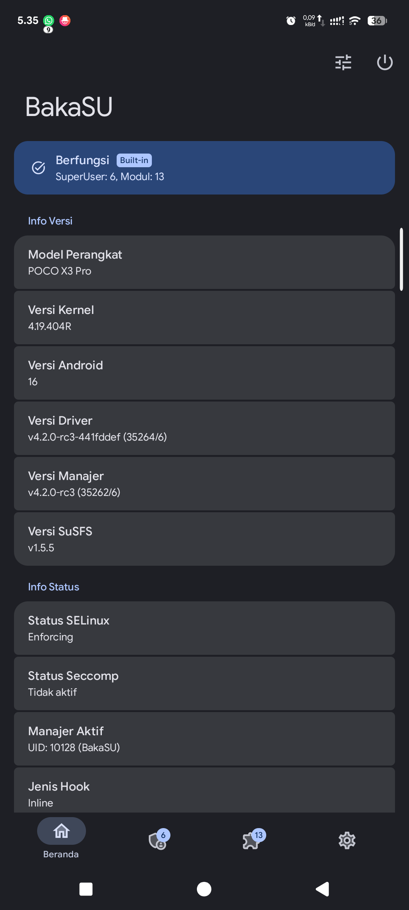

# E404 Custom Kernel for POCO X3 Pro (vayu / bhima)
Built with ReSukiSU (BakaSU v4.2.0-rc3), SuSFS v1.5.5, MGLRU, Turbo Charge 6A (up to 100%), and eBPF

-blue)
-orange)
-green)
-red)
-purple)


---

## Maintainer and Contact
- Compiled and maintained by Dalu Raziq Hidayatullah ([@fakfekrill-glitch](https://github.com/fakfekrill-glitch))
- Base source by [@deutereium](https://github.com/deutereium) ([xiaomi_sm8150_kernel_e404](https://github.com/deutereium/xiaomi_sm8150_kernel_e404))

[](https://t.me/PushyAja)
[](https://instagram.com/dalu.hidayatullah)
[](https://discord.com)

- Telegram: [@PushyAja](https://t.me/PushyAja)
- Instagram: [@dalu.hidayatullah](https://instagram.com/dalu.hidayatullah)
- Discord: `pushygamertag27`

---

## Device and OS Compatibility
- Device: Xiaomi POCO X3 Pro (`vayu` / `bhima`), Qualcomm Snapdragon 860 (`SM8150-AC`)
- Kernel base: Linux `4.14.356` (reports `4.19.404R` via `scripts/POST-GEN.sh` for modern Android compatibility)
- Verified on crDroid 12.13 (Android 16) with MGLRU, BPF, SuSFS v1.5.5, and 6A Turbo Charge active
- Compatible with AOSP custom ROMs from Android 12 to Android 17 (Baklava)
- Compatible with MIUI 12.5, 13, 14 and HyperOS using the Non-BPF build

---

## Kernel Features

### 1. Upstream E404 Base and Compiler Toolchain
- Backports Linux 5.15 Android Binder IPC, `clone3()` syscall, and `bpf_atomic` support for Android 15 to 17+
- Backports Linux 5.10 RCU and 5.10 ZRAM
- Fixes HyperOS slow animations and the 60Hz refresh rate lock after reboot
- Supports multi-IR drivers, removes the 140MHz GPU idle step, and disables CABC
- Compiles with Neutron Clang 24.0.0 and Neutron LLD 24.0.0 (`CONFIG_LTO_CLANG_THIN=y`) with zero compiler warnings across both BPF and Non-BPF defconfigs
- Disables unused `CONFIG_EDAC` and `CONFIG_QCOM_DLOAD_MODE` while keeping `pstore` (`ramoops`) active

### 2. Multi-Gen LRU (MGLRU) and Memory Management
- Enables Multi-Gen LRU (`CONFIG_LRU_GEN=y`, `CONFIG_LRU_GEN_ENABLED=y`) with 4 generations and 4 refault tiers tuned for SM8150 arm64 without hardware accessed-bit page walks (`/sys/kernel/mm/lru_gen/enabled` outputs `0x0001`, using `iterate_mm_list_nowalk()` and `lru_gen_look_around()`)
- Sets `lru_gen_min_ttl` to `0` ms to avoid premature OOM triggers
- Skips zero-scanned non-critical `vmpressure_global()` events so MGLRU aging and sorting passes do not cause false `pressure = 100` kills in Simple LMK (`CONFIG_ANDROID_SIMPLE_LMK=y`)
- Fixes clean file page deactivation (`lru_deactivate_file_fn`) so pages stay on MGLRU generational lists rather than legacy LRU lists, along with fixes for `reclaim_state` initialization, `PG_active` clear ordering, `p4d_entry` pagewalk traversal, IRQ-safe `mm_list->lock`, and fork/exec task tracking
- Uses ZSTD as the default ZRAM compressor (`CONFIG_ZRAM_DEF_COMP_ZSTD=y`) with `page_cluster = 0` to eliminate unnecessary swap readahead decompression
- Tunes VM defaults to `vm_swappiness = 100`, `dirty_background_ratio = 5`, and `vfs_cache_pressure = 80`

### 3. Root and SuSFS Integration
- Built-in ReSukiSU / BakaSU (`v4.2.0-rc3`) with `sulog` and `adb_root` enabled
- Integrates SuSFS `v1.5.5` (`SUS_PATH`, `SUS_MOUNT`, `SUS_KSTAT`, `SPOOF_UNAME`, `SPOOF_CMDLINE_OR_BOOTCONFIG`, `OPEN_REDIRECT`, `SUS_MAP`, and KernelSU/SuSFS symbol hiding)
- Fixes `sucompat` `faccessat` and `stat` user-pointer handling on non-GKI 4.14 kernels and uses heap allocations in `fs/susfs/` to avoid ThinLTO stack overflow warnings

### 4. Fast Charging (6A Turbo Charge to 100%) and Battery Profiles
- The fast-charge driver (`/sys/kernel/fast_charge/force_fast_charge`) defaults to `1`, locking `FCC` to `6,000,000 uA` (6A) while keeping the Charge Pump active up to 100% battery capacity.
- Dynamic `USB_ICL` control remains intact during hardware APSD detection, QC3 500 mA pulse negotiation, and 50 mA main-charger shutdown so VBUS does not collapse on plug-in.
- Aftermarket chargers and third-party cables work across Anker and wide-range 11V, 16V, and 21V PD-PPS adapters, QC3 Class B (6000 mA battery / 3000 mA bus), QC2 (2A), DCP (2.4A), and floating-data cables via AICL.
- Both `BQ25970` and `LN8000` Charge Pumps use faster ramp intervals (80 ms pre-ramp and 200 to 250 ms active current tuning), activate PD FFC automatically on AOSP ROMs without `batterysecret`, and report adapter `current_max` and Turbo Charge status accurately on crDroid and MIUI.
- Switchable Fuel Gauge profiles via `/sys/e404/batt_profile` or `e404_args`:
  - `0` (`batt_def`): OEM battery (`5160 mAh`)
  - `1` (`batt_6k`): `6000 mAh` custom profile (Default)
  - `2` (`batt_65k`): `6500 mAh` custom profile (`fg-gen4-batterydata-vayu-6500mah.dtsi`)
- Supports arbitrary capacity reporting via `/sys/e404/batt_capacity_mah`
- Silences `ds28e16` authentication `dmesg` log spam on aftermarket batteries without OEM crypto ICs

### 5. Networking, Storage, and 120Hz Tuning
- Sets `bbrplus` as the default TCP congestion algorithm (`bbr` and `westwood` also built in) paired with `fq` as the default qdisc (`CONFIG_DEFAULT_NET_SCH="fq"`), TCP Fast Open enabled (`client | server`), and `sysctl_tcp_slow_start_after_idle = 0`
- Enables F2FS compression with `LZO`, `LZ4`, and `ZSTD`
- Lowers `schedutil` rate limit to `1000 us` (1 ms) for 120Hz frame pacing, enables Prime core touch boost in `cpu-boost`, and enables `CONFIG_IRQ_SBALANCE=y`

### 6. Built-in `e404` CLI Fetch Tool
Flashing either AnyKernel3 zip installs the `e404` POSIX/mksh script automatically into available paths (`/data/adb/ksu/bin`, `/data/adb/magisk`, Termux `usr/bin`, or `/data/local/tmp`). Run `e404` in Termux or MT Manager Terminal to view CPU usage and cluster clocks, Adreno 640 GPU load and frequency, RAM and ZRAM compression ratios, Wi-Fi IP/MAC, battery telemetry, TCP congestion control, and MGLRU status.

---

## Verification Proof (BakaSU, SuSFS, and Banking Apps)

Captured on POCO X3 Pro (crDroid 12.13 / Android 16) running BakaSU `v4.2.0-rc3` and SuSFS `v1.5.5`:

<div align="center">
  
  <br /><br />
  <a href="https://github.com/fakfekrill-glitch/xiaomi_sm8150_kernel_e404_modified/releases/download/R3-SuSFS-v1.5.5/E404-BakaSU-SuSFS-MBanking-Proof.mp4">
    
  </a>
  <p><i>Click the badge above to play or download the video demonstration (.mp4)</i></p>
</div>

---

## Kernel Variants and Flashing Guide

| Variant | Recommended OS | Description |
|---|---|---|
| **`RE404-VAYU-ResukiSU-SuSFS-BPF.zip`** | Android 15, 16, 17+ | Enables `CONFIG_ANDROID_16_BPF=y` for modern Android networking (`NetBpfLoad`, offload, tethering). |
| **`RE404-VAYU-ResukiSU-SuSFS-NON-BPF.zip`** | Android 12, 13, 14, MIUI, HyperOS | Standard netd compatibility without Android 15/16+ BPF changes. |

### How to Flash
1. Reboot to custom recovery (OrangeFox Recovery or TWRP recommended).
2. Back up your current `boot` partition if needed.
3. Flash the zip matching your ROM.
4. Reboot to system.
5. Install the ReSukiSU / BakaSU Manager app if not already present.

### Post-Flash Verification (Terminal / Root Shell)
```sh
e404
cat /sys/kernel/mm/lru_gen/enabled /sys/kernel/mm/lru_gen/min_ttl_ms /sys/kernel/fast_charge/force_fast_charge
# Expected:
# 0x0001
# 0
# 1
```

---

## Building From Source

Place `AnyKernel3` and the compiler toolchain (such as `toolchains/neutron-clang`) in the parent directory alongside the cloned kernel directory.

```bash
# Clone the repository
git clone https://github.com/fakfekrill-glitch/xiaomi_sm8150_kernel_e404_modified -b main-susfs kernel
cd kernel

# BPF variant (Android 15, 16, 17+):
./compile.sh vaybpf sus bpf neutron

# Non-BPF variant (Android 12, 13, 14, MIUI, HyperOS):
./compile.sh vayu sus neutron
```

---

## Credits and Acknowledgments
- [@deutereium](https://github.com/deutereium) for the E404 kernel source and Android 15 to 17 backports
- [Baka-SU / ReSukiSU Team](https://github.com/Baka-SU)
- [simonpunk](https://gitlab.com/simonpunk/susfs4ksu) for SuSFS
- [tiann](https://github.com/tiann) for KernelSU
- [osm0sis](https://github.com/osm0sis) for AnyKernel3
- [dakkshesh07](https://github.com/dakkshesh07) for Neutron Clang
- Yu Zhao and Linux MM contributors for Multi-Gen LRU (MGLRU)
- Dalu Raziq Hidayatullah ([@fakfekrill-glitch](https://github.com/fakfekrill-glitch)) for porting, non-GKI 4.14 fixes, tuning, and maintenance

---
License: [GPL-2.0](LICENSE)
